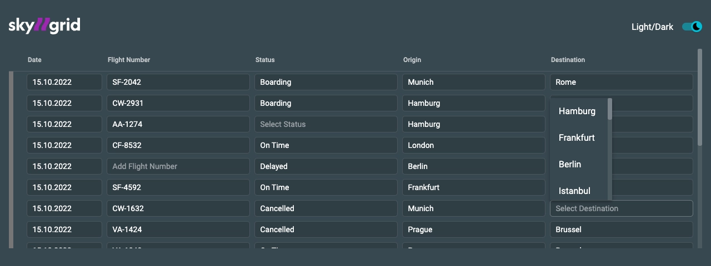
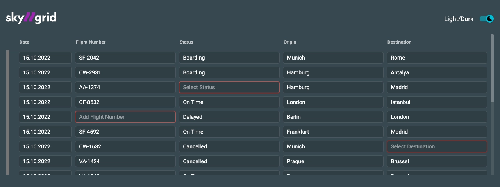
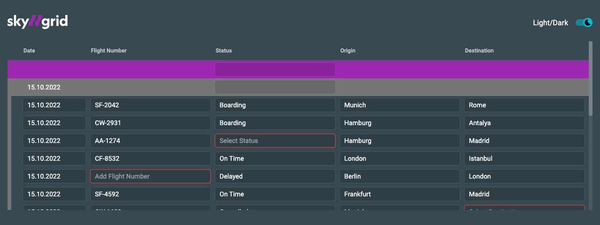
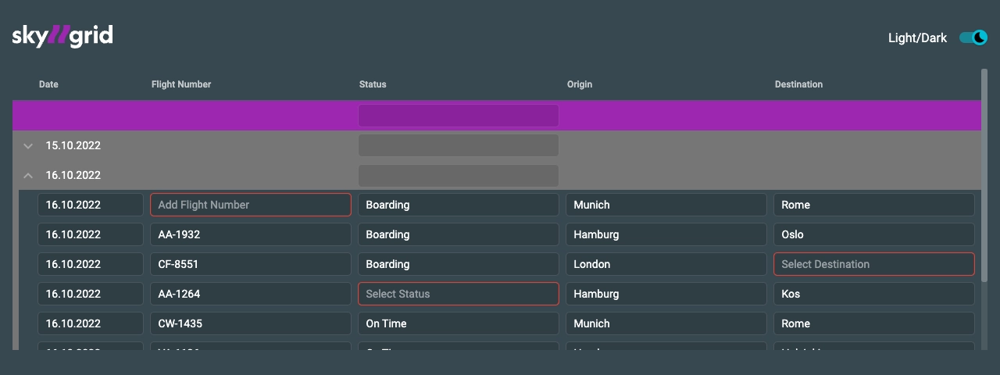

# Installation & Setup

**Enough with the theory!**

Here we would like to give some real examples of how to configure and implement the **datagrid**.
Using the **<a href="/skygrid-app" target="_blank">skygrid demo-app</a>**, we would like to show and explain the datagrid step by step, with concrete code examples.


<br/>

## Installation

:::info
This is a developer preview which currently **only runs on UNIX based systems**! We recommend to use **Node > v14.x**
and **>= v16.x**. If you use Node 14.x then install via `npm i`. For Node 16.x use `npm i -f`.
<br/>

Currently the datagrid is only usable and testable in the **rescoped** repository in the **skygrid demo-app**, with preconfigured test data.
As soon as we are out of developer-preview, which will probably happen **beginning of 2023 Q1**, the **rescoped datagrid** can be consumed via **NPM**.
:::

Install like below

```bash
git clone github/avodaq/rescoped.git
cd rescoped
npm install
npx nx serve skygrid
```
<br/>


## Markup

:::info
In order to continuously achieve good performance, it is essential to use the `cdk-virtual-scroll-viewport` component.
Once we are in **beta**, this component will only be needed for more than 1000 rows.
:::

### Impelement Markup
Impelement the Markup like shown below and use `<ng-container>` to build your **datagrid**.

```html
<cdk-virtual-scroll-viewport [tvsItemSize]="38">
    <mat-table
      mat-datagrid
      #matdatagrid="matdatagrid"
      [itemRules]="itemRules"
      [dataSource]="dataSource"
      [density]="'xs'"
      [rowHover]="true"
      [collapsedRows]="true"
      [cellGap]="2"
      [rowGrouping]="false"
      class="mat-table-gap-2 input-density-xs rows-collapsed rows-grouping hide-divider rows-hover"
    >
      <ng-container matColumnDef="date">
        <mat-header-cell *matHeaderCellDef>
          <span>Date</span>
        </mat-header-cell>
        <mat-cell *matCellDef="let skyItem; type: dataSource">
          <mat-datagrid-input
            cdk-datagrid-edit
            [validator]="standardValidation"
            [item]="skyItem"
            [key]="'date'"
          ></mat-datagrid-input>
        </mat-cell>
      </ng-container>

			...

      <mat-header-row *matHeaderRowDef="tableColumns; sticky: true"></mat-header-row>
      <mat-row
        cdk-datagrid-row
        *matRowDef="let skyItem; columns: tableColumns"
        [item]="skyItem"
      ></mat-row>
     </mat-table>
  </cdk-virtual-scroll-viewport>
```

<br/>

## TypeScript

### Placeholder rule

### 1. Define columns
Define the columns as usual.

```tsx
readonly tableColumns = ['date', 'flightNumber', 'status', 'origin', 'destination'];
```

### 2. Create data model
Create your data model, but wrap it with the `setItemPayload()` function.

```tsx
import { setItemPayload } from '@rescoped/components/datagrid';

const skyGridData: SkyGridData[] = [
  setItemPayload(
    {
      date: '15.10.2022',
      flightNumber: 'SF-2042',
      status: 'Boarding',
      origin: 'Munich',
      destination: 'Rome',
    },
    { actionType: 'single-row' },
  ),
  setItemPayload(
    {
      date: '15.10.2022',
      flightNumber: 'CW-2931',
      status: 'Boarding',
      origin: 'Hamburg',
      destination: 'Antalya',
    },
    { actionType: 'single-row' },
  ),
  setItemPayload(
    {
      date: '15.10.2022',
      flightNumber: 'AA-1274',
      status: '',
      origin: 'Hamburg',
      destination: 'Madrid',
    },
    { actionType: 'single-row' },
  ),

  ...

];
```

:::tip
If you are interested in ways to initialize data on `ngOnInit`, please have a look at the [Angular-Material table examples](https://material.angular.io/components/table/examples) and [Angular-Material table API](https://material.angular.io/components/table/api).
:::

### 3. Define rules
Create your data model, but wrap it with the `setItemPayload()` function.

Define your `placeholder` rules by passing a `string`.

```tsx
const itemRules: GlobalRules<SkyGridData> = {
  'single-row': {
    overrides: {
      flightNumber: {
        placeholder: 'Add Flight Number',
      },
      status: {
        placeholder: 'Select Status',
      },
      destination: {
        placeholder: 'Select Destination',
      },
    },
  },
};
```

### 4. Voilà
Run the project with `npx nx run skygrid:serve`. Voilà, you just created your first **rescoped datagrid**, and you
have access to its cell `placeholders`!




<br/>


## Validation rule

Of course, we want to give the user immediate feedback when he enters a value, so that he can always be sure that he is doing the right thing.

### 1. Configure validation

Configure the validation rules and set `validationCode` and `validationMessage`.

```tsx
const itemRules: GlobalRules<SkyGridData> = {
    'single-row': {
      validate: true, // add validate to your rules
      overrides: {
      ...
      },
    },
};
```


```tsx
readonly flightNumberValidation: DatagridValidation = {
  validator: [
    Validators.required({
      validationCode: 'REQUIRED_FIELD',
      validationMessage: 'Required field',
    }),
    Validators.pattern(/[A-Z]{2}-[0-9]{4}/, {
      validationCode: 'INVALID_FLIGHT_NUMBER_FORMAT',
      validationMessage: 'Invalid flight number format',
    }),
  ],
};
```

### 2. Implement markup

Implement the markup and bind to the custom `[validator]` input.

```tsx
<ng-container matColumnDef="flightNumber">
  <mat-header-cell *matHeaderCellDef>
    <span>Flight Number</span>
  </mat-header-cell>
  <mat-cell *matCellDef="let skyItem; type: dataSource">
    <mat-datagrid-input
      cdk-datagrid-edit
      [validator]="flightNumberValidation"
      [item]="skyItem"
      [key]="'flightNumber'"
    ></mat-datagrid-input>
  </mat-cell>
</ng-container>
```

### 3. Voilà
Your **datagrid** cells get validated, based on your defined validation rules, and you have the option to respond
with an `error` if the corresponding rule does not apply.



<br/>

## Global-row & group-row

We want to create a group of rows in our **datagrid** and configure it in a user-friendly way! And we want that the
entered value in a row should be applied to each cell of a column of the entire **datagrid** or each cell of a
corresponding group. After hitting enter, the entered value should disappear from the `global-row` & `group-row`
cell, so it is quickly ready for use again. To do this, we need to do two things here:

### 1. Define group

<ol>
  <li>
    1. To create a group, we give the <code>group-row</code> and all associated `<code>single-rows</code> a
    <code>groupId</code>. Here, for simplicity,    <b>1234</b>. The <code>groupId</code> is always of type
    <code>number</code>.
  </li>
  <br/>
  <li>
    2. We have to define the <code>group-row</code> as parent by setting <code>parent: true</code>. For the beta,
    it is planned to make <code>parent: true</code> optional.
  </li>
</ol>

<br/>

We extend the previous configuration by these global rules: `actionType`, `parent` and `groupId`.

```tsx
const skyGridData: SkyGridData[] = [
  setItemPayload(<SkyGridData>{}, { actionType: 'global-row' }),
  setItemPayload(<SkyGridData>{ date: '15.10.2022' }, { actionType: 'group-row', parent: true, groupId: 1 }),
  setItemPayload(
    {
      ...
    },
    { actionType: 'single-row', groupId: 1 }, // every single-row has the same groupId as its parent
  ),
  setItemPayload(
    {
      ...
    },
    { actionType: 'single-row', groupId: 1 },
  ),
  setItemPayload(
    {
      ...
    },
    { actionType: 'single-row', groupId: 1 },
  ),

  ...

];
```

### 2. Implement batch-edit behavior

Define your **global rules** and **group rules**. Set `validate: false` to delete the value of the `global-row`
and `group-row` from the cell, after hitting enter.

```tsx
const itemRules: GlobalRules<SkyGridData> = {
  ‘global-row: {
    validate: false,
  },
  ‘group-row’: {
    validate: false,
  },
  'single-row': {
    ...
  },
};
```

### 3. The result

The blue row is the `global-row`, the orange is the `group-row`. Every change in a cell of the `global-row` is
transferred to every `single-row` of **all** following groups. Every change in a `group-row` is transferred to
every `single-row` of the specific group with the `groupId` **1234**.

You can see: We have entered the value **2.111** in the `group-row` **Weight** cell and the `single-rows` have
adapted this value. Since the last two rows have a different `groupId`, they have not taken the new value.



<br/>

## Collapse groups

In most cases, we want to open or close a group, just like an accordion component. Typically, this functionality
is achieved by applying and removing CSS. But we want to keep the performance of the **datagrid** high, even when
scaled up to large data sets. Therefore, we decided to remove the `single-rows` of a corresponding group from the
DOM, instead of simply hiding them with CSS. To implement this behavior, we have developed
the `MatDatagridCollapseComponent`.


### 1. Modify rules


Here, we set `render: false` to make the cell only render a `string` and stop behaving like an input field.

```tsx
const itemRules: GlobalRules<SkyGridData> = {
  'single-row': {
      overrides: {
        'group-by-date': {
           render: false,
        },
        ...
     },
  },
};
```

[link-to-code]

### 2. Implement Collapse

We use the `action` property to import the `MatDatagridCollapseComponent` into the **datagrid** and are able
to use `componentPosition` to configure where in the DOM this component should be rendered. Use `before`, `after`
and `override`.

```tsx
import { MatDatagridCollapseComponent, setItemPayload } from '@rescoped/components/datagrid';

const group1 = setItemPayload(<SkyGridData>{ date: '15.10.2022' });

const skyGridData: SkyGridData[] = [
  setItemPayload(<SkyGridData>{}, { actionType: 'global-row' }),
  setItemPayload(group1, {
    actionType: 'group-edit',
    parent: true,
    groupId: 1,
    rules: {
      overrides: {
        date: {
          action: {
            componentType: MatDatagridCollapseComponent,
            componentPosition: 'before',
            data: {
              item: setItemPayload(<SkyGridData>{ date: '15.10.2022' }),
            },
          },
        },
      },
    },
  }),
  ...
];
```

[link-to-code]

### 3. Voilà

Here you can see the chevron icon at the beginning of the orange `group-row`. This is the
`MatDatagridCollapseComponent`. If you click on it, the corresponding `single-rows` of this group will be
removed from the DOM and by clicking again re-rendered into the DOM.



## Styling

The developer-preview comes with predefined stylesheet. As soon as we are out of the developer-preview, we will
provide more description for this section.

In the meantime, please have a look at our [Theming guide](/docs/datagrid/datagrid-Theming-css/)
